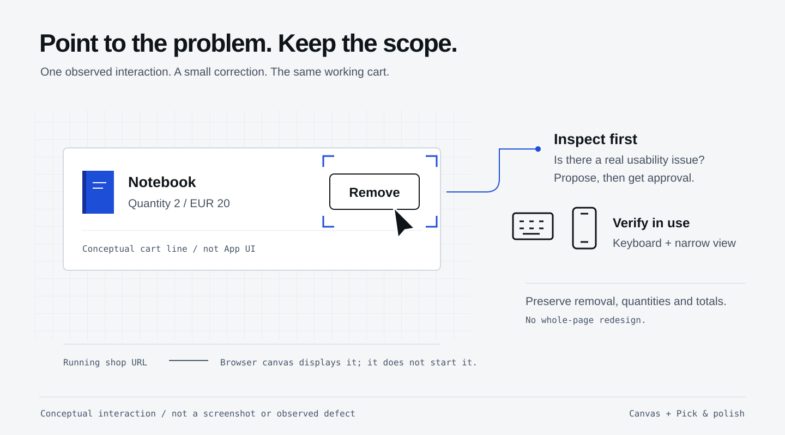

## What you will learn

Use a shared Browser canvas in Copilot App, give Copilot reliable startup
instructions in `AGENTS.md`, and use Pick & polish with **impeccable** to
improve one visible interaction.

## What is a Canvas?

A **Canvas** is an interactive work surface beside the conversation.
You and Copilot can inspect and interact with the same artifact: a web page,
terminal, document or another supported surface.
Here, use the **Browser canvas** to see your running shop and point to a UI
issue without having to describe its location from memory.

The canvas is not the server. It displays a URL; opening it does not build or
start Spring Boot. You do not need to create a canvas extension for this exercise.
See the <a href="https://docs.github.com/en/copilot/how-tos/github-copilot-app/working-with-canvas-extensions" target="_blank">Canvas guide</a>.

<figure>
  <a href="/workshops/copilot-app/assets/illustration-canvas-focus.svg" target="_blank"></a>
  <figcaption>Point to one interaction and keep the correction focused. This schematic is not an App screenshot or evidence of a defect.</figcaption>
</figure>

## Teach Copilot how to run this project
{: #startup-instructions}

Stay in **Cart: remove item**, with the accepted quantity fix and removal
feature. Use **Interactive**. Read the existing `AGENTS.md` first, then ask:

```copilot
Update AGENTS.md only. Preserve the existing acceptance tests, stack,
money rules, privacy boundaries and approval requirements.
Document startup from the active session's working directory:
./mvnw spring-boot:run
The shop URL is http://127.0.0.1:18765.
The human owns the one persistent server. Stop it with Ctrl+C in its
owning terminal before starting another checkout; never kill by process name.
Tests use isolated H2 databases and random ports. A restart resets shop data.
Replace the blanket "no agents" restriction with permission for explicitly
requested workshop collaboration, only when its chapter is reached and approved:
the two isolated worktree tasks with their stated file ownership,
a read-only independent critic after integration, and five bounded checkout
subagents on the later checkout feature branch.
Permit mock-checkout implementation only for that approved later exercise,
not during the earlier tickets. Preserve separate approval for corrections,
publishing and merging. No payments or authentication.
In the checkout chapter, only the orchestrator may publish and merge the
integrated feature through a reviewed PR after separate explicit approval.
The five specialists must not publish or merge.
Show the diff and wait for my approval. Do not run the app or edit other files.
```

This is a narrow update to repository instructions, not permission to bypass
organization rules or install extra tools. The starter currently excludes
agents and checkout; leaving those restrictions unchanged would conflict with
the later collaboration exercises. This amendment does not start those tasks.

Review the diff. Stop any old shop with **Ctrl+C in its owning terminal**.
In this session's directory, start the reviewed copy:

```sh
./mvnw spring-boot:run
```

Keep that terminal open. Give Copilot this prompt in the **same session**:

```copilot
Read AGENTS.md and confirm which source directory owns the running shop.
Check that http://127.0.0.1:18765 responds, then open that URL in the
Browser canvas beside this conversation. Do not start a second server,
create a canvas extension or change files.
```

Confirm the shop appears in the App's side panel. Add products, remove one,
then reload; you are using the application, not a screenshot.

## Pick one interaction to improve
{: #pick-and-polish}

Use the Browser canvas's **Pick & polish** control to select the **Remove**
button on a cart line. In the feedback associated with that selection, use:

```copilot
Use the bundled impeccable skill to inspect this Remove button.
Keep the current design and DELETE behavior. Improve its keyboard-focus
visibility and usability on a narrow screen if those are inadequate.
Only change src/main/resources/static/. No backend, dependencies,
test changes or whole-page redesign. Explain the observed issue and the
smallest proposed correction before editing; wait for my approval.
If the selected interaction already works well, say so instead of inventing
a defect, and help me choose another observed UI issue.
```

**impeccable** supplies UI design and accessibility guidance; the canvas
supplies the selected element and visual context. Neither is a test result
or permission to change the rest of the project.

Review the proposal, approve only the useful correction, then inspect
**Changes**. Stop the shop with **Ctrl+C in its owning terminal**, then restart
from this same session's directory so it serves the changed resources:

```sh
./mvnw spring-boot:run
```

Reload the canvas, add sample products again after the data reset, and check
the actual result with keyboard
navigation and a narrow viewport. Confirm removal, quantities and totals
still work. Run:

```sh
./mvnw -q -Dtest=BaselineTest,CartContractTest,RemoveContractTest test
```

Expect the supplied **10 tests** to pass without removing cases.
Record the selected issue, skill guidance actually used and before/after
observations on the [worksheet](/workshops/copilot-app/worksheet/).

<details markdown="1">
<summary>If generated impeccable files appear in Changes</summary>

Ask Copilot to distinguish generated local state from useful design records.
For an untracked `.impeccable/hook.cache.json`, request a narrowly scoped
local Git exclude and review it before approval. Do not commit the cache,
delete the whole directory or ignore all `.impeccable/` files.
Keep intentional design records; review any proposed source change separately.

</details>

<details markdown="1" id="canvas-recovery">
<summary>If the canvas, picker or skill is unavailable</summary>

Check the running app's URL and owning terminal first; an unreachable server
is not a canvas failure. Control labels and availability can vary by build.
If Browser or Pick & polish is unavailable, preview in your normal browser
and send a screenshot or specific observation in the same session.
If impeccable is absent, use explicit UI acceptance criteria without
claiming that the skill ran. Record the unavailable feature or demonstration.
Do not install an unrelated canvas, expose a public tunnel or expand permissions.

</details>

## Save the reviewed feature for the next session
{: #feature-handoff}

After reviewing the instruction and UI changes, ask Copilot:

```copilot
Commit only the reviewed AGENTS.md and UI changes, if not yet committed.
Create a branch workshop-feature at that accepted commit without switching branches.
Do not replace an existing branch. Confirm the working tree is clean and
the handoff includes the quantity fix, removal feature and accepted Canvas changes.
```

If that branch already exists from an earlier workshop edition, stop and ask
Copilot to preserve it and provide a distinct reviewed handoff for the next
session. Do not silently overwrite it or start the query task from older code.

## What you have learned

- Distinguish the running server from the Browser canvas that displays it.
- Keep startup and bounded workshop permissions in `AGENTS.md`, and run the correct session's checkout.
- Use Pick & polish and **impeccable** for one observed UI issue, then verify behavior rather than trusting the preview alone.
- Preserve the accepted instruction and UI changes in the next session's handoff.
