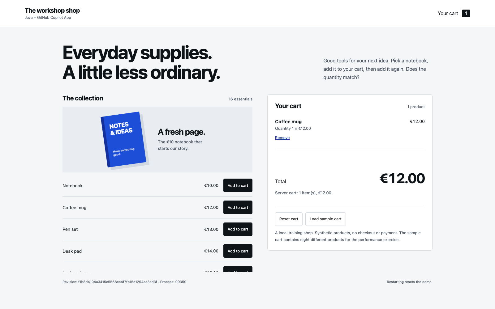

## What you will learn

Give Copilot a feature request with clear acceptance criteria, use a testing
skill and iterate on the generated code in the App.

## “Let me remove something from my cart”

The quantity bug is fixed. Now build a new feature across the backend and UI,
then refine it using tests and browser feedback.

## Start from the reviewed fix

Continue in **the same workshop session, on its current branch**.
The previous chapter committed the accepted quantity fix.
**Do not create a new session or switch branches.** Select **Plan** mode.

Send this prompt to start planning the feature:

```copilot
Confirm this session contains the committed quantity fix and has no
uncommitted changes. If not, stop. Keep the current session and branch.

Customers want to remove a product from their cart without affecting the others.
Plan a small backend and UI implementation with these acceptance criteria:
- Each cart line has a Remove button.
- DELETE /api/cart/items/{productId} returns 200 with the updated cart.
- Removing the final line leaves an empty cart with zero count and total.
- Other products and their quantities stay unchanged.
- Removing a missing line returns 404 without changing the cart,
  including a catalogue product that has never been added.
- Keep server-calculated prices/totals, the existing money representation,
  stack and working quantity behavior.
Plan tests before implementation. No new dependencies, checkout or query changes.
Do not edit files yet; wait for my review.
```

Review the plan in the **plan canvas on the right**. Ask for corrections if
it omits the UI or an edge case. When the plan is ready, leave planning without
launching implementation and return to **Interactive** in this same session.

## Generate the removal tests

The requirements are already in the plan. Invoke **`/spring-boot-testing`**
with this task in the App composer:

```copilot
/spring-boot-testing
Generate src/test/java/com/juliendubois/workshop/RemoveContractTest.java
from the removal acceptance criteria in our reviewed plan.
Use the existing HTTP test fixtures, random ports and isolated H2.
Cover removing one of two products, removing the final line, and removing
a missing line, including a catalogue product never added to the cart.
Assert HTTP status, returned cart contents, quantities and totals,
and verify stored state with a subsequent GET /api/cart.
Generate tests from our criteria; do not retrieve reference tests or solutions.
Do not implement removal, change earlier tests or add dependencies.
Explain how you used the skill. Show the test diff and wait for my review
before running or committing.
```

Review the assertions in **Changes**. They should describe the requested
behavior and preserve the other products, not just check that a DELETE
request returns successfully. After reviewing, run:

```sh
./mvnw -Dtest=RemoveContractTest test
```

**Removing an existing line must fail before implementation**: the starter
does not yet support that behavior. Check the actual assertion failure;
compilation errors, HTTP setup failures and zero executed tests do not count.
Missing-line tests may already pass. There is no fixed test or failure count.

Ask Copilot to commit only the reviewed tests once they demonstrate the missing
feature. Keep those assertions unchanged during implementation.

## Generate the backend and UI

Stay in **Interactive** to guide the work, or choose **Autopilot** if you want
Copilot to carry out this reviewed scope with fewer pauses. Send:

```copilot
Implement the removal feature from our reviewed plan, including the DELETE
endpoint and a working Remove button on each cart line.
Keep all reviewed tests and assertions unchanged.
Preserve the quantity fix, other cart items, server-calculated totals
and existing money representation. No new dependencies, checkout or query changes.
Run ./mvnw -Dtest=BaselineTest,CartContractTest,RemoveContractTest test.
Show the backend and UI diff, actual test counts and results.
Wait for my review before committing.
```

The **4 baseline tests and all generated cart and removal tests** must pass.
Review every changed file, not just the endpoint. Check that the button sends
the request, updates cart lines/count/total from the response and shows errors.
If a test fails, fix the implementation rather than weakening the assertions.

## Preview and iterate

Stop the old shop with **Ctrl+C in its owning terminal**, then restart from this
reviewed session's directory:

```sh
./mvnw spring-boot:run
```

Open <a href="http://127.0.0.1:18765" target="_blank">the shop</a>.
Add a Notebook and another product. Remove the Notebook and check that the other
product, its quantity and the total remain correct. Remove the last product and
confirm an empty cart with zero count/total. Reload to check the stored result.

<figure>
  
  <figcaption>A complete feature includes the customer interaction, not just an endpoint.</figcaption>
</figure>

If you observe a problem, give Copilot the action, actual result and expected
result. For example, **if the total is stale**, use:

```copilot
After removing the Notebook, its line disappears but the total still includes it.
Update the displayed total from the server response while preserving the other
cart items. Add regression coverage for this behavior using the existing tooling.
Rerun the cart and removal tests, then show me the diff before committing.
```

Report your actual observation, not the example if it does not happen.
After a correction, review the diff, rerun the combined test command above,
restart the shop from this session and repeat the browser checks.

## Save the feature and continue

Once tests and browser checks pass, ask Copilot:

```copilot
Commit only the reviewed removal feature and its test changes, if not yet committed.
Confirm the working tree is clean and includes both the quantity fix and
removal feature. Keep the current session and branch.
```

Continue to [Canvas and Pick & polish](/workshops/copilot-app/canvas/) in
**this same session**.

If the implementation is blocked, preserve your work and use
[a reference checkpoint](/workshops/copilot-app/facilitator/#recovery).
Continue to the Canvas exercise with a working feature, noting whether you
implemented it yourself or continued from the reference.

## What you have learned

- Build on the committed quantity fix in the same session and branch.
- Turn a customer request into a reviewed plan, then use **/spring-boot-testing** to generate tests before the backend and UI.
- Review the full diff, test edge cases and use specific preview feedback to correct the generated feature.
