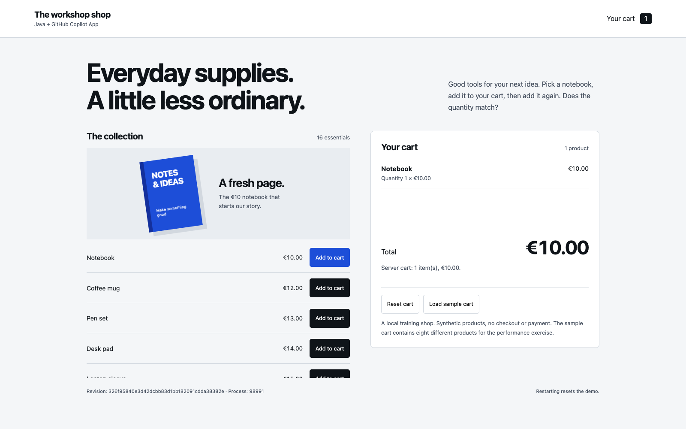

## The scenario

> **“I added the notebook twice. Why is there still only one in my cart?”**

In this **hands-on workshop**, use **GitHub Copilot App** to understand
the code, reproduce a bug, generate a feature and review what actually changed.
Investigate a Hibernate N+1 query through MCP, coordinate two parallel sessions,
then use **Chronicle** to improve your workflow.

The shop is intentionally small: Spring Boot, H2 and plain JavaScript.
You do not need Docker, a payment provider, a frontend build or advanced
Hibernate knowledge. BootUI supplies runtime data **through MCP** for the
performance exercise.

<a class="btn btn-ink" href="/workshops/copilot-app/setup/">Prepare your workshop</a> <a class="btn btn-ghost" href="https://github.com/jdubois/copilot-shopping-cart-workshop" target="_blank">Get the template</a>

<figure>
  
  <figcaption>The starter application after adding the Notebook twice: a bug to investigate and fix with Copilot.</figcaption>
</figure>

## One shop, three tickets

| Ticket | Customer outcome | App practice |
|---|---|---|
| Fix adding the same product twice | Quantity and total accumulate correctly | Plan, use a Java skill, reproduce a failing test and guide the fix |
| Generate item removal | Remove one product without losing the others | Define expected behavior, generate backend and UI code, preview and iterate |
| Fix repeated product queries | The cart keeps its contents with fewer SELECTs | Use MCP evidence, diagnose with a skill, verify the query budget |

Start with **Fusion Standard**, or a strong coding model if Fusion is unavailable.
Use higher effort when a problem calls for it, not by default.
Review permissions, tests and changed files at every stage.

## Workshop flow
{: #workshop-flow}

Start with [setup](/workshops/copilot-app/setup/), then follow the chapters in
order. There are no chapter deadlines. Take a break before the parallel work
and ask for help whenever you need it.

1. [Reproduce the cart bug](/workshops/copilot-app/ticket/) and get familiar with the App.
2. [Plan with Copilot](/workshops/copilot-app/fusion/), then [use a skill and add a regression test](/workshops/copilot-app/skills/).
3. [Fix, review and verify](/workshops/copilot-app/verify/) the repeated-add behavior.
4. [Generate the remove-item feature](/workshops/copilot-app/generate/).
5. [Investigate the N+1 query through MCP](/workshops/copilot-app/tools/).
6. [Work in two isolated sessions](/workshops/copilot-app/parallel/) to improve the empty-cart experience and add boundary tests.
7. [Review and integrate](/workshops/copilot-app/integrate/) the two worker PRs with Agent Merge, one at a time.
8. [Improve token usage with Chronicle](/workshops/copilot-app/tokens/) using the workshop sessions.
9. [Review the full change and hand off](/workshops/copilot-app/finish/#final-review).

## Before you begin

You need JDK 21+, Git and a supported Copilot App account. Create your own
repository from the template; the three Java skills are already included.
The integration exercise also needs GitHub Actions and permission to push
branches and merge PRs; local recovery is documented for blocked participants.
The skills chapter also explains how to install them in another project.
Keep the [prompt cards](/workshops/copilot-app/prompts/) and
[worksheet](/workshops/copilot-app/worksheet/) nearby.
