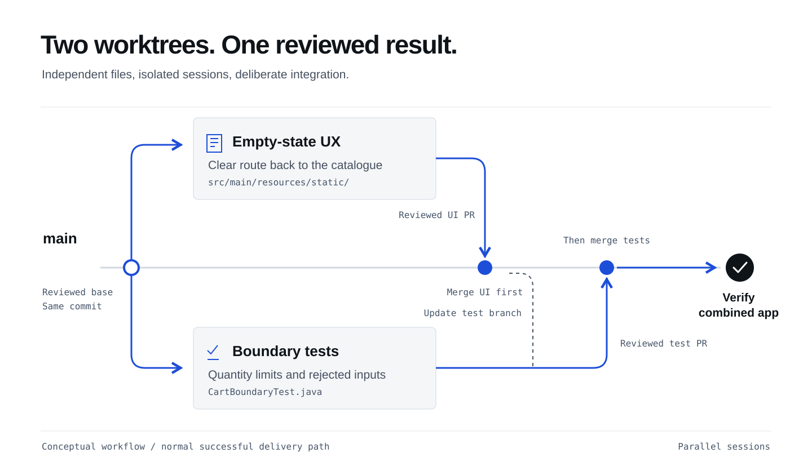

## What you will learn

Create two Copilot App sessions in separate worktrees, starting from the same
reviewed version. Their tasks may touch the same files.

## Create two sessions from main
{: #update-main}

The quantity, removal-and-Canvas and MCP PRs must be merged before continuing.
Use the updated **`main`** verified at the end of the
[MCP chapter](/workshops/copilot-app/tools/#publish-the-reviewed-result).

In the **Copilot App UI**, create two project sessions with **isolated worktrees**.
Choose **New worktree** for each and select **`main` as the base branch** for both.
Send the corresponding task prompt below to start each session, then rename it
once the conversation has started.
Both sessions start from that same published version. Keep each on its own
branch; **do not have both edit `main` directly**.

If you already created the sessions from an older baseline, keep them and ask
Copilot to update their branches from the verified `origin/main`, preserving
local work and asking before resolving conflicts.

If the MCP handoff could not be published, use the
[local recovery steps](#local-recovery) instead of claiming `main` is updated.

<figure>
  <a href="/workshops/copilot-app/assets/illustration-parallel-worktrees.svg" target="_blank"></a>
  <figcaption>Separate working copies, reviewed conflict resolutions, one tested result.</figcaption>
</figure>

| Session | Task | Done means |
|---|---|---|
| Cart: empty-state UX | Improve the empty-cart experience | Empty cart includes a clear link back to the catalogue, accessible by keyboard and usable on mobile |
| Cart: boundary tests | Test quantity boundaries and review any exposed bugs | HTTP tests cover missing quantity, fractional `1.5`, string `"one"` and exactly 99 units; rejected input preserves the cart |

Both sessions may edit the same files: each worktree has its own working copy.
Overlapping changes can conflict when merged. **Agent Merge** can help resolve
those conflicts; you still review the resolution and test the combined result.
Each prompt belongs in only one session.
**Both prompts are below; you do not need to open another page.**

### Cart: empty-state UX
{: #ui-worker}

Prepare the first new session with the settings above. Send this prompt
to start it:

```copilot
Improve the empty-cart state with a clear keyboard-accessible link to the
catalogue; preserve cart behavior and mobile usability.
Keep changes focused on this interaction and preserve earlier tests.
No API changes or dependencies. Preview the UI, review the diff, commit,
and report the actual branch/commit, checks and limitations.
Do not open or merge a PR yet.
```

Once the session has started, rename it **Cart: empty-state UX**.
Leave it working while you create the second session.

### Cart: boundary tests
{: #test-worker}

Prepare the second new session with its own **New worktree**, also based on
`main`. Send this prompt to start it:

```copilot
Use spring-boot-testing to add CartBoundaryTest.java and reuse existing fixtures.
Use HTTP integration tests for missing quantity, non-integer quantity
(numeric 1.5 and string "one") and exactly 99 units.
For rejected input, require HTTP 400, then verify GET /api/cart and persisted
state are unchanged.
Preserve earlier tests and reviewed behavior.
If a test exposes a bug, keep the failing test and propose the smallest fix.
Wait for my approval before changing application behavior.
Do not weaken an assertion to make the test pass.
Run the new cases and full suite. Commit only reviewed changes and report the
actual branch/commit, executed counts, any failures and limitations.
Do not open or merge a PR yet.
```

Once the session has started, rename it **Cart: boundary tests**.

The testing skill helps this second session write and run the HTTP tests.
If those tests reveal a bug, review the proposed correction before proceeding.

<details markdown="1" id="boundary-fix">
<summary>If a boundary test exposes an application bug</summary>

Keep the failing regression in **Cart: boundary tests**. Review the exact
request, expected behavior and proposed fix, then approve the smallest correction
in that same session. Preserve earlier tests and rerun the full suite.
Do not weaken assertions or proceed while the regression still fails.
Include the reviewed correction in this session's handoff and PR.

</details>

## Supervise without sharing a working directory

**App tip:** review each session's changes against its task, not a list of
exclusively owned files. Separate worktrees do not guarantee conflict-free merges.

Check progress and clarify the task when needed. Give each session time to work
instead of repeatedly asking for updates or starting more agents.
Each worker reviews and commits its changes, then reports its branch, commit
and test results.

For the UI preview, [move the running shop](/workshops/copilot-app/setup/#move-running-shop)
to **Cart: empty-state UX**, then have Copilot reload the existing Browser canvas.
Tests use random ports and isolated H2; **Cart: boundary tests** does not need
another persistent shop. Do not reuse preview evidence from a different branch.
The MCP investigation is finished; these tasks do not need additional BootUI work.

Before integration, preserve unfinished branches and review what is actually
ready. Ask for help if either worker is blocked.
Do not let the workers open or merge PRs yet. In the next chapter, you will
target both worker PRs at **`main`**,
and use **Agent Merge** one PR at a time.

<details markdown="1" id="local-recovery">
<summary>Recovery: the MCP handoff could not be published</summary>

Ask the facilitator for help. Do not bypass protections or continue with
failing acceptance tests. If GitHub, CI or approvals are unavailable but the
reviewed local query-fix version passes all earlier reviewed tests, ask Copilot to commit
only that accepted work and report its actual branch and commit.

Create both isolated worker sessions from **that recorded local branch**
instead of `main`. Record that shared starting commit before editing, then use
the same task prompts. Keep the tasks and review requirements unchanged.

Record **main not updated: local recovery used** and any open MCP handoff PR.
Continue with the integration chapter's local recovery, not its remote PR
steps. Do not report local integration as GitHub or Agent Merge completion.

</details>

## What you have learned

- Confirm the reviewed work is published on `main`, then create two isolated sessions from that same starting point.
- Give each session a focused task; separate worktrees keep working copies isolated even when files overlap.
- Review the contributions and use Agent Merge to help resolve conflicts before verifying the combined result.
