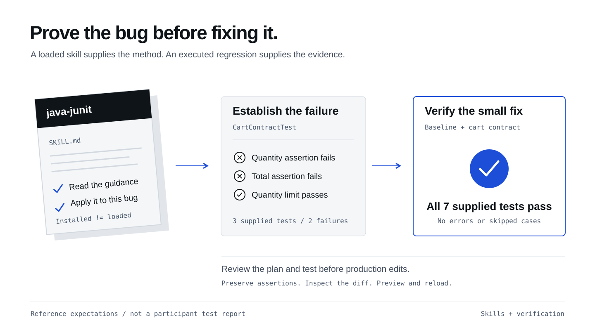
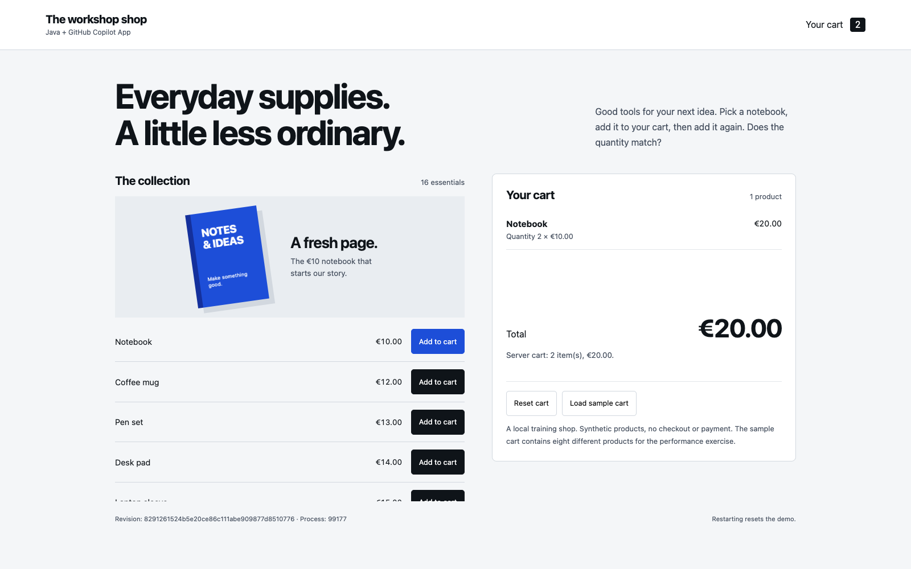

## What you will learn

Find and load a relevant skill in Copilot App, generate tests that expose the
bug, then guide the fix, review the changes and verify the result.
You will also learn how to install skills in another project.

## What is a skill?

A **skill** is a folder of reusable instructions and resources for a task,
such as writing Java tests. Its `SKILL.md` explains when and how to use it;
references or scripts may supply additional guidance.
Installation makes the skill available. Loading it brings the relevant
guidance into Copilot's current task. Neither grants new tool permissions.

## Find the installed skills
{: #skills-are-already-installed}

**No installation is needed for this workshop.** Your repository created from
the template already includes complete, pinned skills in `.github/skills/`.

| Skill | When it helps |
|---|---|
| `java-junit` | Reproduce the cart bug and review assertions |
| `spring-boot-testing` | Generate and review HTTP tests for item removal |
| `java-hibernate-jpa` | Diagnose the N+1 query during the MCP exercise |

The later Canvas exercise uses **impeccable**, bundled with the App.
These three Java skills are instead bundled with the **repository**.

## Install skills in another project
{: #install-skills}

For a project without these skills, inspect the source and complete skill
folder before installing it. Use the destination project's root, not this
workshop's checkout; keep its existing pinned copies unchanged.
Follow the
<a href="https://github.com/github/awesome-copilot/blob/main/docs/README.skills.md#how-to-use-agent-skills" target="_blank">official Awesome Copilot instructions</a>.
With **GitHub CLI 2.90.0+**, install into `.github/skills/` at repository scope
using the pinned commands below, or copy complete skill folders manually.

<details markdown="1">
<summary>Pinned installation commands for another project</summary>

```sh
gh skills install github/awesome-copilot java-junit --pin 7e408815ddcb64889a3683799a85399331cfd4ef --dir .github/skills
gh skills install github/awesome-copilot spring-boot-testing --pin 7e408815ddcb64889a3683799a85399331cfd4ef --dir .github/skills
gh skills install github/awesome-copilot java-hibernate-jpa --pin 7e408815ddcb64889a3683799a85399331cfd4ef --dir .github/skills
```

The source revision and destination match this workshop. The CLI adds its own
installation metadata, so installed files may have different hashes from the
bundled copies. You can also copy complete skill folders, including references.
Keep the workshop's existing copies unchanged.
</details>

Confirm the destination contains each `SKILL.md` and its bundled resources.
Then ask Copilot in that project's session to load the skill and identify
the guidance it actually read. If the skill is not discovered, check its
location and name before retrying; do not claim that installation alone ran it.
You can learn the installation process here without changing repositories
or reinstalling the workshop's skills.

## Use the skill with /java-junit

Stay in **Cart: quantity bug**, in **Interactive** mode. Your plan and its
[acceptance criteria](/workshops/copilot-app/modes/#acceptance-criteria)
are already in this conversation; you don't need to paste them again.
The criteria describe the expected behavior. Now ask Copilot to connect those
requirements to test assertions: for example, adding the €10 Notebook twice
needs assertions for quantity **2** and total **€20**.

Type **`/java-junit`** in the App composer to invoke the installed skill,
then include the task in the same message:

```copilot
/java-junit
Use the acceptance criteria in our quantity-fix plan to propose regression
tests. Explain which assertions would check each requirement, including
quantity accumulation, server-calculated totals and rejected input.
Explain one skill rule that applies and report which guidance you loaded.
Do not edit files or implement the fix yet.
```

Check Copilot's response: it should explain the proposed coverage and how it used
the skill, not just repeat the skill's name. The skill instructions live in
`.github/skills/java-junit/SKILL.md`.

**App tip:** load the skill needed for the current task, not every installed skill
on every turn. General skill advice does not override this
workshop's **H2, no-Docker, no-new-dependency** boundary. If a skill recommends
Testcontainers or a different database, retain H2 and explain that constraint.

## Generate the regression tests

Review the proposed assertions, then ask Copilot to generate the tests in the
**same session**:

```copilot
/java-junit
Generate src/test/java/com/juliendubois/workshop/CartContractTest.java
from the acceptance criteria and test approach we just reviewed.
Use the existing JUnit and HTTP test fixtures, random ports and isolated H2.
Cover repeated additions, adding to an existing quantity, a new product,
quantity limits and unchanged state after rejected input.
Assert server-calculated totals as well as quantities.
Generate tests from our criteria; do not retrieve reference tests or solutions.
Do not change production code, add dependencies or weaken existing tests.
Show me the test diff and wait for my review before running or committing.
```

Open **Changes** and review the generated assertions against the criteria.
They must expect the correct behavior, not encode the current bug. For example,
two Notebook additions must expect quantity **2** and total **€20**.
Ask Copilot to explain any assertion you don't understand, then run:

```sh
./mvnw -Dtest=CartContractTest test
```

PowerShell: use `.\mvnw.cmd`. Read the Maven summary and, if needed,
`target/surefire-reports/com.juliendubois.workshop.CartContractTest.txt`.

**The repeated-add regression must fail on the unfixed application.** Check
that the failure shows the quantity or total mismatch caused by the bug.
The test count depends on what Copilot generated; do not expect a fixed count
or number of failures. Compilation errors, a missing JDK, HTTP setup failures
or a run with no tests are not evidence of the bug. If everything passes,
check that the generated tests actually reproduce repeated additions.

Once the reviewed tests demonstrate the bug, ask Copilot to commit only the
test changes. Keep their assertions unchanged while implementing the fix below.
The starter contains no ready-made exercise tests. The removal and query
exercises also generate their tests; reference tests are separate facilitator
resources, not files to copy during this exercise.

If setup or skill loading is blocked, ask the facilitator for help. If you use
a reference example, note which steps you ran yourself.

<figure>
  <a href="/workshops/copilot-app/assets/illustration-skills-and-tests.svg" target="_blank"></a>
  <figcaption>Use the skill to generate tests, demonstrate the bug, then verify the fix without weakening the assertions.</figcaption>
</figure>

## Implement the agreed fix

Stay in **Cart: quantity bug**, in **Interactive** mode. You have reviewed the
plan and observed the failing regression tests. Now authorize the production-fix
step:

```copilot
Implement the quantity fix from our reviewed plan.
Keep the reviewed regression assertions and all existing tests unchanged.
Preserve validation, server-calculated prices/totals and other cart items.
Do not add dependencies or implement removal, checkout or query optimization.
Run ./mvnw -Dtest=BaselineTest,CartContractTest test.
Show me the changes and test results for review before committing.
```

The **4 baseline tests and all generated cart tests** must pass, with no
errors/skips. The total depends on the generated tests. Compare the cart cases
with the failing run: keep every reviewed assertion and confirm the same
regressions now pass.
Check the test command and its output, not just Copilot's summary.

## Review in the App

Open **Changes**. Find the accumulated-quantity change, confirm validation still
applies to the sum, and inspect every changed file. Review any added tests.
The generated regression tests should retain the assertions you reviewed.

**App tip:** give file-specific feedback. “Keep `CartRepository.java` unchanged;
this ticket only fixes quantity accumulation” is actionable. Do not accept
unrelated cleanup just because the summary sounds convincing.

## Verify the shop

Keep the shop running **from this reviewed session's directory**. The test run
compiled the fix; **DevTools** restarts the app automatically. Wait for startup
to finish in its terminal, then reload the browser. If the server is stopped,
follow the [startup guidance](/workshops/copilot-app/setup/#start-the-application).
If it belongs to another worktree, use the
[server handoff](/workshops/copilot-app/setup/#move-running-shop).

Open <a href="http://127.0.0.1:18765" target="_blank">the shop</a>.
Reset the cart, add the Notebook twice, and reload: quantity **2**, total **€20**.
An App browser canvas can keep the preview beside your work where available;
a normal browser works too.

<figure>
  
  <figcaption>The reference fix. Run the tests and preview your own version to check the same behavior.</figcaption>
</figure>

## Publish the quantity fix

Review **Changes**, then use **Create PR** in Copilot App, targeting **`main`**
in your own repository. If the PR already exists, open it instead.
Review **Files changed** and the **tests** CI job.
Once you accept the result, ask Copilot:

```copilot
Merge this reviewed quantity-fix PR into main in my own repository only after
all required checks and approvals pass. Do not bypass protections.
Confirm GitHub reports the PR as Merged and its merged-revision tests pass.
Fetch origin/main and verify it contains the quantity fix and CartContractTest.java.
Report the PR link and verified main commit.
```

Record the handoff on the [worksheet](/workshops/copilot-app/worksheet/).
**Do not start removal until this PR is merged and verified.**
Continue to [Generate and iterate](/workshops/copilot-app/generate/) in a
**new session from that updated `main`**. Keep this session's history and branch.

If you are stuck, keep your unfinished work and review
the <a href="https://github.com/jdubois/copilot-shopping-cart-workshop/tree/v2-bugfix" target="_blank">v2-bugfix reference checkpoint</a>
in a [separate reference checkout](/workshops/copilot-app/facilitator/#recovery).
Do not overwrite your session.

## What you have learned

- Distinguish installed skills from loaded guidance, and install complete pinned folders in another project without replacing the workshop's copies.
- Ask Copilot to use a specific installed skill and explain how its guidance applies to the current task.
- Keep the workshop's stack and dependency limits even when a general-purpose skill suggests other tools.
- Generate regression tests from acceptance criteria, review them in **Changes** and demonstrate the bug before implementing the fix.
- Guide the fix without weakening the tests, review every changed file and verify that the shop keeps the correct quantity after a reload.
- Publish one reviewed quantity-fix PR and verify merged `main` before starting the removal session.
