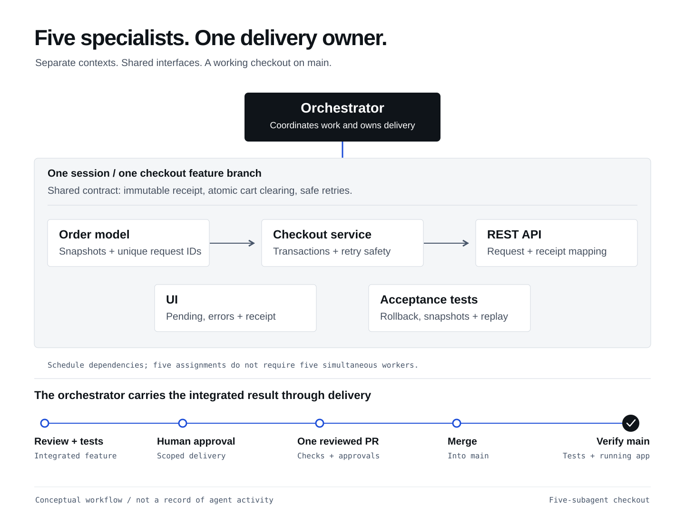

## What you will learn

Use Copilot App to delegate a shared goal to **five subagents**, route questions
between specialists and deliver their integrated feature into **`main`**.
The orchestrator owns the checkout PR, checks, authorized merge and verification
of the application actually merged.

## One goal, five perspectives

**Customer request:** “Let me place a mock order, see a receipt and start
shopping again with an empty cart.”

**Mock means no real payment processing**, not an unimplemented feature.
Build a working local checkout after the three earlier tickets and parallel
improvements. Keep Spring Boot, H2, vanilla JavaScript and server-owned integer-cent prices.
No payments, authentication, customer personal data or external services.

The **orchestrator** is the main Copilot agent in your existing
**Cart: boundary tests** session. A **subagent** works on a delegated task in
its own context window. Five role assignments do not require five custom
agent files, five new App sessions or five branches.

Earlier, two worktree sessions built independent changes. Rubber ducking
challenged the result. Here, five specialists agree on shared interfaces
and build one feature together, with explicit file ownership and dependencies.
See <a href="https://docs.github.com/en/copilot/concepts/agent-capabilities/choosing-and-delegating-agent-work/delegating-and-parallelizing-work-with-agents" target="_blank">how delegation works</a>.

<figure>
  <a href="/workshops/copilot-app/assets/illustration-five-specialists.svg" target="_blank"></a>
  <figcaption>Five implementation specialists, one delivery owner. This is a conceptual workflow, not evidence that agents have run.</figcaption>
</figure>

## Prepare one feature branch
{: #prepare-checkout}

Stay on the latest reviewed result, including local recovery if used.
Keep **Interactive** and review tool-permission requests.
The integration chapter may have left this worktree on a detached verification
checkout. Do not implement there or switch to `main`. In this session's composer:

```copilot
Confirm this is my reviewed combined shopping-cart result in my own repository,
including all three earlier tickets and accepted UI/boundary-test changes.
If local recovery was used, keep that checked result, not incomplete remote main.
Confirm the working tree is clean; stop if there is unfinished work.
Create and switch to a new branch workshop-checkout at this exact checked commit,
in this session's existing worktree. Do not replace an existing branch; ask me
if the name is taken. Preserve worker branches, main and other session checkouts.
Read AGENTS.md. If needed, propose only a narrow instruction update permitting
the explicitly approved mock-checkout implementation and five bounded subagents
on this feature branch. Reserve checkout publishing and merging for the
orchestrator after separate explicit approval of the integrated result.
Preserve existing tests, stack, privacy and approvals.
Show any instruction diff and wait for approval. Do not implement checkout,
spawn subagents, push, open PRs or merge yet.
```

Review and accept any instruction change before continuing, including when
recovery restored the starter's restrictions. This branch holds the checkout
feature; the earlier merged `main` and worker branches stay intact.

## Agree on the contract first
{: #checkout-contract}

| Case | Required result |
|---|---|
| Submit a nonempty cart | `POST /api/orders` with a client-generated UUID `requestId`; first success returns **201** and a receipt |
| Receipt | `orderId`, `requestId`, `items`, `itemCount`, `totalCents`; each item snapshots `productId`, `name`, `priceCents`, `quantity`, `lineTotalCents` |
| Successful creation | Store the order snapshot in H2 and clear the cart in the same transaction |
| Missing or invalid request ID | **400**, with no order or cart mutation |
| Empty cart with a new request ID | **409**, with no order |
| Retry the same request ID | **200**, returning the same stored order; never create another order or clear a later cart |
| Failure while creating the order | Roll back both order creation and cart clearing; report an error, not success |
| UI | Place order, visible pending/error states, receipt and return to shopping; retain the request ID when retrying after a lost response |
| Cart refresh fails | Show uncertain cart state and offer a GET-only refresh; a known receipt must not trigger another order POST |
| Asynchronous completion | Cart totals, count and status agree with the authoritative cart; receipt totals stay separate; do not steal focus the user moved elsewhere |

The server reads the cart and its prices; the browser does not submit trusted
line items or totals. Receipt data must not change when the catalogue or cart
changes later. Concurrent submissions of the same request ID must also produce
one order, not two successes with different IDs.
Validate `requestId` first: invalid or missing IDs return 400 even when the
cart is empty. For a valid ID, check for an existing order before checking
the cart; a successful retry must not become an empty-cart error.
Keep an unresolved request ID across reloads. A definitive 400 or 409 retires
that attempt, but new checkout stays locked until an authoritative cart refresh
succeeds. Storage failure must be visible, not silently replaced by a new ID.

The current template has `CartService`, `CartRepository` and `CartController`,
not a separate cart entity. Ask Copilot to inspect your actual implementation
before choosing transaction and concurrency boundaries.
Keep the existing one-SELECT **GET `/api/cart`** budget and supplied query
tests unchanged when adding checkout reads.

## Give each subagent a bounded job

| Subagent | Code it owns | Decision it must coordinate |
|---|---|---|
| Order model | New order/snapshot entities and order repository | How are receipt snapshots and unique request IDs stored? |
| Checkout service | Checkout logic and necessary existing cart-service/repository changes | How are creation, clearing and retries kept atomic? |
| REST API | New checkout controller and request/receipt mapping | Which fields and errors must UI and tests use? |
| UI | Changes under `src/main/resources/static/` | How are pending, failure, retry and receipt states shown? |
| Acceptance tests | New `CheckoutContractTest.java` and any agreed test-only helpers | How are rollback, immutable snapshots and duplicate requests proved? |

Ask the **main agent** to prepare the implementation plan before launching workers:

```copilot
Read this branch's cart implementation and propose a mock-checkout plan.
Use POST /api/orders with a UUID requestId, 201 for a new order,
200 with the same receipt for a retry, 400 for an invalid requestId,
and 409 for an empty cart with a new requestId.
Validate requestId first; return a stored order before checking whether
the cart is empty. Preserve the one-SELECT GET /api/cart budget.
Receipt fields are orderId, requestId, items, itemCount and totalCents;
item fields are productId, name, priceCents, quantity and lineTotalCents.
Snapshot server data, create the order and clear the cart atomically.
Retries, including concurrent ones, must not duplicate orders or clear a later cart.
Keep all earlier behavior and supplied tests unchanged. No new dependencies,
payments, authentication, personal data or external services.
Assign exact, non-overlapping files to five roles: Order model, Checkout service,
REST API, UI and Acceptance tests. Identify dependencies and explain how
transaction boundaries and concurrency protect cart mutations.
Plan meaningful failure/rollback and immutable-receipt tests, not only happy paths.
Do not edit code or launch agents yet. Show the plan and wait for my approval.
```

Approve the contract and file list first. The order model comes before service
code that uses it, and the API depends on that service. UI and HTTP tests can
be drafted from the agreed contract. **Five assignments do not mean five
independent coding tasks** or five simultaneous Maven runs.
Agree on a concurrency limit suited to the machine before launching; check
active workers again before starting or waking another worker.

In the **same session's composer**, use the App's **`/fleet`** command:

```copilot
/fleet Implement the approved mock-checkout plan on this session's
workshop-checkout feature branch, never on a detached checkout or main.
Use exactly five subagents: Order model, Checkout service, REST API,
UI and Acceptance tests. Give each the approved contract, exact owned files,
dependencies, existing source and AGENTS.md. Do not assume shared context.
POST /api/orders accepts a UUID requestId. Return 201 for new creation,
200 and the same receipt for replay, 400 for invalid requestId and
409 for an empty cart with a new requestId.
Validate requestId first; return a stored order before checking whether
the cart is empty. Preserve the one-SELECT GET /api/cart budget.
Receipt fields: orderId, requestId, items, itemCount, totalCents.
Item fields: productId, name, priceCents, quantity, lineTotalCents.
Snapshot server prices and quantities. Create the stored order and clear
the cart atomically; failure leaves it intact. Concurrent or later retries
must not duplicate orders or clear a later cart.
Keep Spring Boot, H2, vanilla JavaScript, original response fields and all
earlier reviewed tests. No payments, authentication, personal data,
new dependencies, agent profiles or further nested agents.
Workers edit only assigned files. Schedule dependencies, and coordinate
interface questions through available messaging; otherwise relay them.
Before dependent implementation, have receiving specialists check the actual
upstream interface. Relay unresolved questions and their answers before proceeding.
Respect the agreed concurrency limit during follow-ups as well as launches.
Stop and ask before expanding scope or resolving conflicting ownership.
Workers must not run Maven, start/stop the shop, change branches, commit,
push, open PRs or merge. You own the integrated test run, not five workers.
Wait for all five workers to finish and confirm no worker is still writing files.
Then review the combined diff and run ./mvnw test.
Confirm BaselineTest, CartContractTest, RemoveContractTest, QueryContractTest,
CartBoundaryTest and new CheckoutContractTest execute without failures or skips.
Fix actionable failures within the approved ownership; never weaken tests.
Report the five actual contributions, meaningful exchanges, final file list,
executed test counts and anything incomplete. Wait for my review before committing.
If delegation cannot run, stop and report it rather than inventing agents.
```

The roles are defined by this prompt; they are not necessarily names in the
App's agent picker. **`/fleet` delegates within the session**.
Do not substitute **`/orchestrate`**, which coordinates separate App sessions
and repositories, for this exercise.

## Watch how they communicate
{: #communication}

Subagents have separate contexts. They do not automatically know another
agent's discoveries. The orchestrator provides the shared brief, passes
relevant information between them and tracks the decisions.
Where the build supports direct peer messaging, agents can exchange questions
and report the decisions back; otherwise the orchestrator relays them.

For example, the API agent confirms the agreed `requestId` field. The UI agent
asks when to retain it after a timeout. The service agent explains how a stored
order is returned without clearing a newly filled cart, while the model agent
confirms the unique request-ID constraint. The test agent verifies that replay.
This is an **example exchange**, not evidence that your agents performed it.

Inspect the actual agent activity and report. Confirm there are five distinct
contributions and that code and tests use the agreed interfaces.
Report missing contributions or unsupported messaging honestly.
Record actual questions and answers, or explicitly **none exchanged**.
Do not manufacture dialogue to fill the worksheet; assignments alone do not
demonstrate collaboration.

## Review and run the integrated feature
{: #verify-checkout}

Check that the UI and API use the same fields and errors, data transactions
match the clearing rule, and tests cover failure, snapshots, concurrent duplicate
submissions and replay after new items have been added. Check the test reports:
all **earlier reviewed tests**, boundary tests and **new checkout
tests** must execute with no failures/errors/skips. The generated checkout
tests are additional cases, not a new supplied reference checkpoint.

Stop the old shop with **Ctrl+C in its owning terminal**. In this same
feature branch's directory, restart the changed application:

```sh
./mvnw spring-boot:run
```

Ask Copilot to open or reload **http://127.0.0.1:18765** in the Browser canvas.
Add the €10 Notebook twice: the receipt must show quantity **2** and total
**€20**, followed by an empty cart. Check visible error feedback for a
failed request, then return to shopping. If Place order is disabled on an empty
cart, verify the required **409** through HTTP tests; do not enable it just
for this demonstration. Confirm keyboard access and a narrow
viewport. A disabled button alone does not prove server-side duplicate prevention;
use the HTTP regression results for retry, rollback and concurrency evidence.
Also move focus to the catalogue while a real response is pending: completion
must respect that choice. Check the cart's live status as well as its visible
total, and inspect the complete focus ring during natural Tab scrolling.

<details markdown="1">
<summary>Make failure and concurrency evidence meaningful</summary>

The transaction boundary must include physical commit, not just the body of
an annotated Java method. Inject failure after a real write and verify both
order and cart roll back. For overlap, hold an uncommitted write and establish
that a second request entered the server; two client futures alone are not proof.
Compare receipts as parsed wire JSON so Java UUID or numeric node types do not
create a test-harness mismatch.

If simulating a lost response, let the real server commit, record its response,
then discard delivery and retry the same ID after reload. Label fault injection;
never fabricate a successful backend response. Save raw outcomes and viewport
screenshots before assertions or cleanup, bound the probe, and close each owned
helper even when another cleanup fails. An incomplete probe is not a pass.

</details>

Review **Changes**, the full starter-to-current result, tests and the running
checkout before authorizing delivery. Include any corrections from the earlier
independent critique. The five workers remain implementation specialists:
only the orchestrator owns Git and PR operations.

## Deliver checkout into main
{: #deliver-checkout}

Stay in **Cart: boundary tests**. The orchestrator delivers **one checkout PR**,
not five specialist PRs or another App session. Earlier preparation and worker
PRs must already be merged into your own `main`; if local recovery was used,
resolve those delivery blockers first or keep the result explicitly incomplete.
Do not publish a recovered combined branch against incomplete remote `main`
as though the earlier PRs had merged.

After accepting the final diff and preview, give this scoped delivery approval:

```copilot
I approve this reviewed checkout result for delivery in my own workshop repository.
You, the orchestrator, own this delivery; the five workers must not publish or merge.
Confirm all five workers have finished and none can still modify this worktree.
Confirm the repository, current checkout feature branch, full intended diff and
new files. Stop if anything is outside the approved checkout and reviewed corrections.
Confirm the preparation and both worker PRs are merged into this repository's main.
Fetch origin. If main advanced, review any needed integration, ask before resolving
conflicts and rerun the full suite before publishing.
Commit only the accepted implementation, tests and reviewed instruction changes.
Push only this feature branch without force-pushing, then open one checkout PR
with base main and head this branch. Reuse an existing PR only if its repository,
head and base match this checkout delivery.
Confirm the linked PR is this checkout PR, not the earlier merged boundary-test PR.
Do not reopen or retarget earlier PRs or create duplicate PRs.
Address CI failures and review feedback only within the approved contract.
Preserve all original acceptance tests, boundary tests and checkout regressions.
Wait for the tests job and all required checks and approvals to pass for the
current PR head. Missing, skipped, queued or failed checks are not a pass.
Abort delivery if any identity, review or check read fails or times out.
Never let a merge command run after a failed guard.
Then squash-merge this checkout PR into main under this approval.
Do not push directly to main, bypass protections, broaden permissions or delete branches.
Ask before out-of-scope changes; stop and report unavailable required approval.
Report the PR URL, accepted head, actual merge status and merge commit.
Do not call the workshop complete until merged-main verification also succeeds.
```

Confirm any required App permission prompts. This authorizes this delivery only,
not unrelated PRs or later changes. The earlier **Agent Merge** exercise remains
separate; no second configuration exercise or extra worker is required here.

## Verify the merged application
{: #verify-merged-checkout}

A green feature branch or a merged PR alone is not the final result. Ask the
same orchestrator:

```copilot
Confirm the checkout PR is Merged in my own repository and record its merge commit.
Check the tests job and all required checks for that exact merged revision on main.
Fetch origin and show the latest origin/main commit. Confirm it includes checkout
and all earlier accepted work, accounting for squash merges rather than requiring
the feature commit to be an ancestor.
Confirm this worktree is clean; stop without overwriting unfinished work.
Check out the exact latest origin/main commit for verification in this same worktree.
If main is checked out elsewhere, use a detached verification checkout here.
Do not move another worktree, reset branches, delete refs or edit this checkout.
Confirm the checked-out commit equals origin/main. If main has advanced since the
merge, require passing checks for this revision too, then run ./mvnw test here.
Confirm all earlier reviewed tests, boundary tests and new checkout tests
execute without failures, errors or skips.
Show the absolute directory and shop URL for restarting this verified application.
Record the checkout PR, merge commit, verified main commit, checks and any blocker.
```

The human still owns the one persistent server. Stop the previous shop with
**Ctrl+C in its owning terminal**, then start the app from the absolute directory
the orchestrator just verified:

```sh
./mvnw spring-boot:run
```

Reload **http://127.0.0.1:18765** in the Browser canvas. Confirm **Place order**
is present, add the €10 Notebook twice and check the receipt shows quantity **2**
and **€20**, the cart clears, and returning to shopping works.
Opening a canvas or selecting another repository does not replace a running
server. Check its owning directory if you still see an older application.

**Done when:** the checkout PR is merged into your own `main`, merged-revision
checks and local verification pass, and the app running from the verified main
revision demonstrates checkout. Record the PR, commits, actual five contributions
and preview evidence on the [worksheet](/workshops/copilot-app/worksheet/).
Then continue with Chronicle and the final handoff.

<details markdown="1">
<summary>Availability, cost and recovery</summary>

Five agents are a teaching example, not automatically the most efficient
choice for a small app. Each consumes model usage. Check the `/` picker and
permissions; do not broaden account access to make `/fleet` work.
Concurrency depends on your build and machine: five total assignments can
be scheduled in smaller batches, and must not be reported as five simultaneous
agents unless that actually happened.
If delegation is unavailable, use a facilitator's demonstration or an explicitly
approved single-agent implementation. Mark it as **not a completed five-agent run**.
If coding or tests fail, preserve this branch and earlier worker refs; record
checkout as unfinished and continue the handoff with the earlier reviewed result.
Do not discard work, weaken assertions or invent a successful receipt.
If GitHub, CI or required approval blocks publication or merging, preserve the
branch and any open checkout PR. Mark **verified locally; delivery blocked**,
not complete. Do not substitute a direct push or local merge into `main`.
If the PR merged but post-merge checks or preview fail, record **merged;
post-merge verification blocked**. Any repair needs a separately approved
follow-up feature branch and reviewed PR; never edit the verification checkout.
The published reference checkpoints do not include checkout.

</details>

## What you have learned

- Distinguish delegated subagents from separate App worktree sessions and reusable custom-agent definitions.
- Give each specialist owned files and sufficient context, then use actual questions and answers to coordinate dependent implementations.
- Verify atomic checkout, immutable receipts and retry behavior alongside all earlier tests and the running UI.
- Let one orchestrator deliver the integrated feature through a reviewed PR, then verify the exact merged-main application rather than an older running copy.
- Distinguish locally verified work, merged and verified delivery, and blocked or unavailable capabilities.
