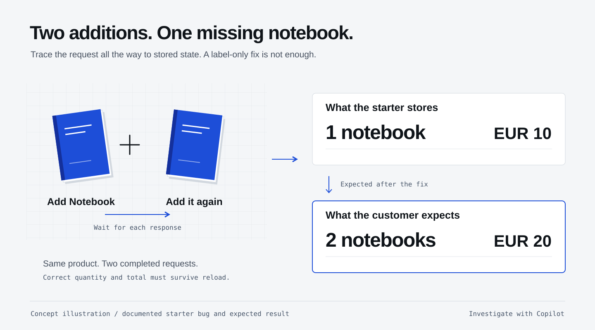

## What you will learn

Give Copilot a clear bug report and ask it to trace the cause before editing code.

## “I added it twice. There is still only one.”

In the shop, click **Reset cart** and wait for it to finish. Click
**Add Notebook to cart**, wait for the response and the button to re-enable,
then click it again. A rapid double-click may send only one request because
the UI disables buttons while a request is pending.
The Notebook costs €10. The starter shows **quantity 1 / €10**;
the customer expects **quantity 2 / €20**.

This is not just a label problem. The server has replaced the existing quantity.
Your fix must survive a page reload.

<figure>
  <a href="/workshops/copilot-app/assets/illustration-quantity-bug.svg" target="_blank"></a>
  <figcaption>Two completed requests, one incorrect stored quantity. Trace the behavior beyond the screen.</figcaption>
</figure>

## Continue in your existing session
{: #give-copilot-a-useful-ticket}

Continue in the **Copilot App project session** named **Cart: quantity bug**
that you created in [setup](/workshops/copilot-app/setup/#open-it-in-copilot-app).
**No new session or GitHub issue is needed.**
Paste this into that session's composer to investigate without editing yet:

```copilot
After resetting the cart, I added the Notebook (1000 cents) twice,
waiting for each request to finish before the next click.
The shop shows quantity 1 and total 1000 cents; I expect quantity 2
and total 2000 cents, including after a page reload.
Trace adding the same product twice from the shop UI through
POST /api/cart/items to persisted state. Explain why the quantity
does not accumulate. Do not edit files yet. Name the relevant
files and any assumptions that need a test.
```

**App tip:** attach or reference the relevant files when you know them, rather
than pasting the whole repository or every log. Ask for the path from click to
database, not a generic review of Spring Boot.

## Acceptance criteria

- Adding 1 Notebook twice produces one line, quantity 2, total 2000 cents.
- Adding 2 more units to an existing quantity 3 produces quantity 5.
- Adding a new product still works. Quantities remain 1–99, including
  the accumulated quantity; rejected input leaves state unchanged.
- Prices and totals come from the server. Do not patch only the UI.

Keep the scope small: no checkout, stock management, accounts, new dependencies
or query optimization yet. The later performance ticket is a separate task.

## What you have learned

- Describe reproduction steps, the observed result and the expected result in a focused App session.
- Ask Copilot to trace a request from the UI to the database without making changes, using relevant files instead of the whole repository.
- Set acceptance criteria and exclusions so Copilot fixes the reported behavior without expanding the task.
