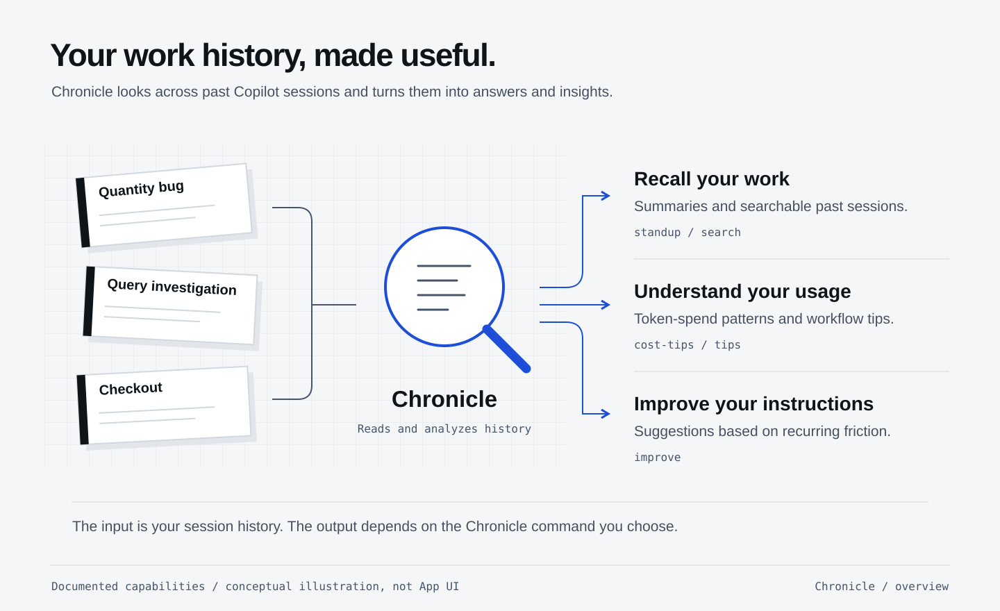

## What you will learn

Use Chronicle in Copilot App to understand reported token usage and costs,
check history privacy and choose one practical workflow improvement.

## Review your workshop sessions

You have fixed a bug, generated a feature, polished the UI, investigated a query
problem, coordinated parallel work, requested a critique and delegated checkout
implementation. Instead of memorizing token prices, use **Chronicle
in GitHub Copilot App** to examine those sessions and their integration.

**Goal:** reduce unnecessary token usage without relaxing tests or code review.

<figure>
  <a href="/workshops/copilot-app/assets/illustration-chronicle-history-insights.svg" target="_blank"></a>
  <figcaption>Chronicle turns session history into insights. Here, use its cost tips to understand your workshop workflow.</figcaption>
</figure>

## Decide before analyzing history

Chronicle can access history across repositories. Selecting cost tips may start
that analysis immediately: a later workshop-only prompt **cannot undo prior
access**. Before selecting it, decide whether you are comfortable with the
history it may use. A repository name or a request to filter the report does not restrict which
history the command can access.

**You may opt out.** If the accessible history is unsuitable, or you cannot
verify an offered pre-execution scope control, do not launch the analysis.
Review your workshop transcript locally instead, choose one better prompt,
and record **"Chronicle not run: privacy choice."** You can complete this
exercise by reviewing the transcript instead. Do not project personal history
on a classroom screen.

## Open Chronicle if you opted in

Type this in the **App composer, not a terminal**:

```copilot
/chronicle
```

Check that the picker appears. If Chronicle is unavailable in your build,
review your workshop transcript locally instead and record **"Chronicle not available."**

After that privacy decision, choose the cost/token-usage tips entry in your
App's picker. The
<a href="https://docs.github.com/en/copilot/concepts/copilot-surfaces/github-copilot-app#optimizing-ai-usage-in-the-github-copilot-app" target="_blank">App documentation</a>
currently shows `/chronicle cost tips`; the
<a href="https://docs.github.com/en/copilot/how-tos/copilot-cli/use-copilot-cli/chronicle#chronicle-cost-tips" target="_blank">CLI reference</a>
calls it `/chronicle cost-tips`. Choose the entry shown in your App; the command
spelling may differ from the CLI.

Prepare the request below with the **session names shown in the App sidebar**,
your repository, and the workshop start/end time. IDs are optional if your App
exposes them. If your build accepts initial scope instructions, supply them
before execution. Otherwise, after opting in to the command's broader access,
use it as a follow-up to narrow the **report**, not as a claim of isolation.
Check the returned scope; if unrelated work appears, stop and do not share it.

```copilot
Analyze only my shopping-cart workshop sessions [session names/IDs],
in [repository] during [start/end time and timezone].
Exclude unrelated projects and conversations. State which sessions
and data you actually used. Do not edit files.

Explain where token usage appears to accumulate. Report input,
output and cache-related counts only if exposed, with their units
and coverage. Mark unavailable fields unknown. Identify two concrete
workflow improvements, tied to examples in these sessions, while
preserving all acceptance tests and review checks.
```

## Understand the usage report

| Look for | What it may teach you |
|---|---|
| Repeated broad file reads or entire logs | Point to relevant files, request IDs and the failing test |
| Repeated follow-up corrections | Include reproduction steps, expected behavior, exclusions and acceptance criteria in the first prompt |
| Unrelated work in one long session | Start a focused session with a verified handoff when the task changes |
| Unnecessary skill/reference loading | Load useful guidance on demand, not every installed skill |
| Effort/model choices | Use Fusion Standard or your chosen coding model; use higher effort when the task needs it |

Look for these patterns in the report; they will not appear in every workflow.
A short prompt can cause an expensive search; a longer, precise prompt can
prevent several retries. Use the sessions you already have rather than running
an intentionally inefficient prompt for comparison.

### Distinguish tokens, credits and cost

Input/output/cache counts, when available, describe token usage for the reported
scope. `/context`, where exposed, describes the active window—not total workflow
consumption. Credits, model-weighted usage and billed currency are different
quantities. Preserve Chronicle's labels and units; do not turn an unexplained
cost field into dollars.

Fusion can make additional calls. Do not infer complete Fusion accounting from
the main conversation alone. Missing usage is **unknown, not zero**.
The same applies to the rubber duck and five-subagent exercise: include their
usage only if exposed, and distinguish five assignments from five simultaneous
agents. More agents are not proof of lower cost or better quality.
Caching can change cost without changing task quality or raw token counts.

## Change one habit

On the [worksheet](/workshops/copilot-app/worksheet/), record:
**observation → supporting session/example → next action → checks retained**.
For example, replace “fix the cart” with the reproduction, relevant endpoint,
acceptance criteria and exact regression command.

Use that improved brief for the final review. Keep the same tests and evidence
requirements. Different tasks are not a controlled cost comparison, so do not
treat their usage differences as proof of savings.

If history is not available yet, use the actual workshop transcript to identify
a repeated read or unclear prompt and mark Chronicle “not observed.”
A new account may not have enough history; record usage as unavailable rather
than guessing figures. Run the analysis once, not after every message, because
the analysis itself also consumes resources.

Ask Copilot to suggest **one short repository instruction** for a recurring
problem you identified. Record it as a suggestion for now; **do not edit the
verified main checkout** or silently add commits after checkout delivery.
If you explicitly choose to apply it, use a new follow-up feature branch.
That change needs its own review, publishing/merge approval, PR and verification.
For local recovery, preserve the checked result and create a normal branch before
any separately approved edits.
Describe expected savings as a prediction until you measure them.

Continue with the [final review and handoff](/workshops/copilot-app/finish/).

## What you have learned

- Decide whether Chronicle's history access is appropriate before running an analysis, or review the workshop transcript without it.
- Read token, cache, credit and cost fields with their reported units and coverage, keeping unavailable data separate from zero usage.
- Connect a usage pattern to a specific session and improve the next prompt or project instruction without weakening acceptance criteria.
- Distinguish a suggested saving from a measured result; a different task's lower usage does not prove that the change saved tokens.
