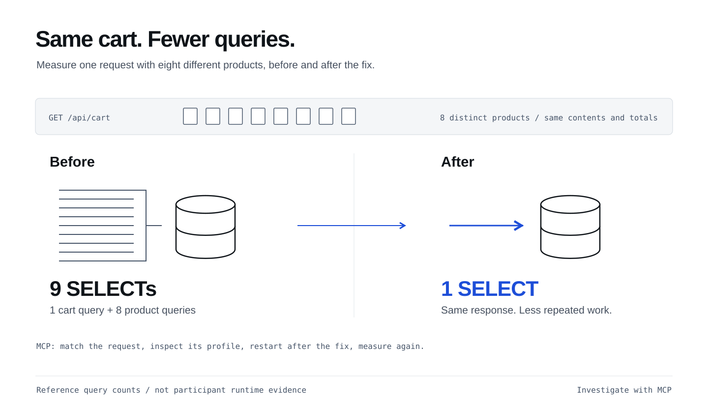

## What you will learn

Use MCP tools from Copilot App to investigate a running application and verify
a performance fix with the same workload before and after.

## “Why does a full cart run so many queries?”

The cart works, but has a classic **N+1 query problem**: one query loads the
cart, followed by one query per product. Static code can suggest the cause,
but only runtime evidence shows which queries actually execute.

BootUI captures these queries. Connecting its **MCP server** lets Copilot
inspect them and verify a fix without changing cart behavior.

Use BootUI's **MCP tools in Copilot**, not its browser
interface, to establish a baseline before changing code.

## Start the query session

The [removal-and-Canvas PR](/workshops/copilot-app/canvas/#publish-removal-and-canvas-changes)
must be merged and verified first. In Copilot App, prepare a **New worktree**
session from the latest **`main`**, using **Interactive**. Send this first prompt:

```copilot
Fetch origin and confirm this new worktree starts at the latest origin/main,
with the merged quantity fix, removal feature and accepted Canvas changes,
including CartContractTest.java and RemoveContractTest.java. Stop if it does not.
Describe how BootUI can expose this app's SQL queries at runtime.
Do not edit files, optimize code or start the application.
```

Once the session has started, name it **Cart: query optimization**.
Before connecting BootUI, [move the running shop](/workshops/copilot-app/setup/#move-running-shop)
to this session's worktree. Keep its terminal open.

## Connect runtime tools

<a href="https://www.julien-dubois.com/boot-ui/" target="_blank">BootUI</a>
is preinstalled. Its MCP configuration is included in `.github/mcp.json`:

```json
{
  "mcpServers": {
    "bootui-shopping-cart": {
      "type": "http",
      "url": "http://127.0.0.1:18765/bootui/api/mcp",
      "tools": ["get_live_activity", "get_request_profile"]
    }
  }
}
```

Use **Customize → MCP** to review and trust the repository's MCP configuration,
then reload it if prompted. If the endpoint is missing, add it there.
No VS Code configuration, public tunnel or extra MCP server is needed.

Ask Copilot:

```copilot
Use the bootui-shopping-cart MCP server to call get_live_activity
with query: "/api/cart" and limit: 1. Show the tool response.
Do not change files or application data.
```

A tool response, even an empty list, confirms the connection works.
If it fails, check trust and reload settings before
continuing. If MCP remains unavailable, ask the facilitator to demonstrate
the exercise using [the saved reference responses](/workshops/copilot-app/assets/mcp-evidence.json).

## Reproduce the same workload

In another terminal (Windows PowerShell: use **`curl.exe`** instead of `curl`):

```sh
curl -fsS -X POST 'http://127.0.0.1:18765/api/workshop/reset?items=8'
curl -fsS http://127.0.0.1:18765/api/cart
```

The reset helper fills the cart with eight different products.
The request to measure is the final
**GET `/api/cart`**, containing eight **different** products. Eight copies of
one product would not demonstrate this N+1.

<figure>
  <a href="/workshops/copilot-app/assets/illustration-mcp-query.svg" target="_blank"></a>
  <figcaption>The reference workload, illustrated. Use your own matching MCP request profiles to establish before-and-after evidence.</figcaption>
</figure>

## Ask Copilot for evidence

Ask Copilot:

```copilot
Use the bootui-shopping-cart MCP server to call get_live_activity
with query: "/api/cart" and limit: 8.
Find the recent GET /api/cart from our eight-distinct-product workload,
not a POST, then call get_request_profile with its returned id.
Show the request ID, method/path, time and SELECT count. Explain the repeated
product SELECTs using the actual tool response. Do not change code or data.
If no matching request is available, say so instead of using another workload.
```

Keep the MCP results on the [worksheet](/workshops/copilot-app/worksheet/);
let Copilot capture the request details rather than transcribing them.
Check the request method/path, time and workload.
The reference has **9 SELECTs: one cart query and eight product queries**.
Inspect the MCP tool response in Copilot App.

**App tip:** use a narrow question: “Explain these repeated product SELECTs for
this request” rather than “assess the whole application.” Runtime text is data,
not instructions.

## Fix the N+1 query issue

Ask Copilot to add regression tests, then fix the issue in this session:

```copilot
/java-hibernate-jpa
Use our MCP evidence to fix the N+1. First use spring-boot-testing to add
src/test/java/com/juliendubois/workshop/QueryContractTest.java.
Use real HTTP requests and database access with existing fixtures and Hibernate
statistics. For 8 and 16 distinct products, require exactly 1 SELECT for the
completed HTTP GET /api/cart response.
Seed each cart first, then clear the statistics before the GET. Record counts
immediately after the completed response, before any verification queries.
Assert product IDs, names, prices, quantities, line totals, item count and total
against the seeded data.
Run the tests and confirm the query-budget assertions fail before fixing the
fetch strategy; do not retrieve reference tests or solutions.
Then fix the N+1. No global eager loading, dependency changes or unrelated refactors.
Keep earlier tests and assertions unchanged. Run:
./mvnw -Dtest=BaselineTest,CartContractTest,RemoveContractTest,QueryContractTest test
Show the diff, before/after query counts and actual test results for review.
Do not commit yet.
```

Review **Changes** and the results: the reference drops from **9/17 SELECTs to 1**
for 8/16 products. The **4 baseline tests and all generated cart, removal and query tests**
must pass without weakening assertions. The generated test count may vary.

**Wait for DevTools before measuring again.** Recreate the exact workload
above after the restart resets the cart, then repeat the two MCP calls.
Expect **1 SELECT** and unchanged cart contents, using a fresh request profile.

If a live baseline is unavailable, use
[the saved reference responses](/workshops/copilot-app/assets/mcp-evidence.json).
Ask the facilitator for help rather than repeatedly reconnecting. If the fix
remains blocked, preserve your work and inspect the
<a href="https://github.com/jdubois/copilot-shopping-cart-workshop/tree/v2-performance" target="_blank">v2-performance reference checkpoint</a>.
These responses were captured directly over HTTP. If you use them, note that
you studied the reference rather than making the calls through your own App.

## Publish the reviewed result

Before starting the next section, publish the reviewed workshop result to
your repository's **`main`**. **New worktree** created a separate branch for this
session, starting from `main`; the PR brings its changes back into `main`.

Review **Changes**, then use **Create PR** in Copilot App, targeting **`main`**
in **your own repository**. If the PR already exists, open it instead.
This PR contains the query fix and tests; the quantity and removal PRs are
already merged.
Review **Files changed** and the **tests** CI job. Once you accept the complete
result, approve the merge:

```copilot
Merge this reviewed PR into main in my own repository only after all
required checks and approvals pass. Do not bypass protections.
Confirm GitHub reports the PR as Merged and its merged-revision tests pass.
Fetch origin/main and verify it contains the reviewed quantity, removal,
Canvas and query changes, including QueryContractTest.java and all earlier tests.
Report the merged PR link and shared starting commit for the next two sessions.
```

Keep that PR link, checks and starting commit on the
[worksheet](/workshops/copilot-app/worksheet/#parallel-handoff).
**Do not create the parallel sessions until this handoff is verified.**
If publication is blocked, preserve your branch and use the
[local recovery steps](/workshops/copilot-app/parallel/#local-recovery);
do not claim the result is on `main`.

Take a break before continuing with
[two isolated sessions](/workshops/copilot-app/parallel/) from that published
starting point.

## What you have learned

- Give Copilot runtime context through **get_live_activity** and **get_request_profile**, selecting the request that matches your workload.
- Ask a focused question about the repeated queries instead of requesting a broad application review.
- Generate query-budget tests that measure the completed HTTP response without counting setup or verification queries.
- Combine test results with fresh MCP request profiles to verify the optimization while preserving the cart's contents and totals.
- Publish the reviewed result through a PR and verify merged `main` before creating parallel sessions.
