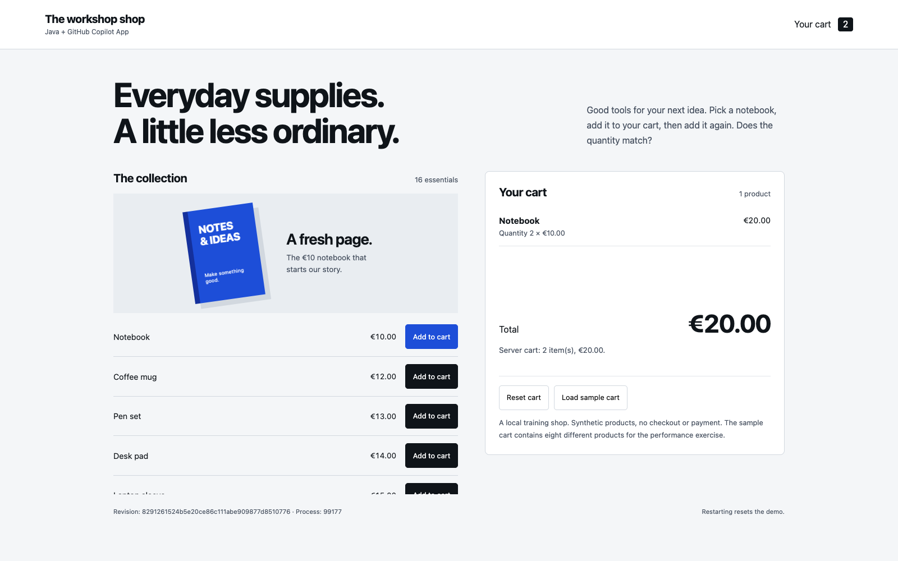

## What you will learn

Guide implementation in Copilot App, review the diff and verify the fix before
saving a branch for the next task.

## Implement the agreed fix

Approve the small plan, then ask for implementation. Keep the failing assertions
unchanged. Ask it to run:

```sh
./mvnw -q -Dtest=BaselineTest,CartContractTest test
```

The supplied classes contain **7 tests**, all green, with no errors/skips.
Additional tests in those classes can increase the count; keep all supplied
cases and judge by their execution and zero failures, not an exact total.
Check the test command and its output, not just Copilot's summary.

## Review in the App

Open **Changes**. Find the accumulated-quantity change, confirm validation still
applies to the sum, and inspect every changed file. Review any added tests.
The supplied acceptance test should still match its teaching copy.

**App tip:** give file-specific feedback. “Keep `CartRepository.java` unchanged;
this ticket only fixes quantity accumulation” is actionable. Do not accept
unrelated cleanup just because the summary sounds convincing.

After reviewing the change, ask Copilot to save the next ticket's starting point:

```copilot
Commit only the reviewed quantity fix and its test changes, if not yet committed.
Create a branch workshop-quantity at that accepted commit without switching branches.
Do not replace an existing branch. Confirm the working tree is clean and
the handoff branch points to this accepted result.
```

Stop the persistent app with **Ctrl+C in its owning terminal**, then restart it
**from this reviewed session's directory**:

```sh
./mvnw spring-boot:run
```

Follow the [session handoff checks](/workshops/copilot-app/setup/#session-handoffs),
not the source path from an older terminal.
Reset the cart, add the Notebook twice, and reload: quantity **2**, total **€20**.
An App browser canvas can keep the preview beside your work where available;
a normal browser works too.

<figure>
  
  <figcaption>The reference fix. Run the tests and preview your own version to check the same behavior.</figcaption>
</figure>

If you are stuck, keep your unfinished work and review
the <a href="https://github.com/jdubois/copilot-shopping-cart-workshop/tree/v2-bugfix" target="_blank">v2-bugfix reference checkpoint</a>
in a [separate reference checkout](/workshops/copilot-app/facilitator/#recovery).
Do not overwrite your session.

Later, after the feature and MCP exercises, [review the full
change](/workshops/copilot-app/finish/#final-review) before handing it off.

## What you have learned

- Give file-specific feedback in **Changes** and keep implementation within the agreed scope.
- Check both test output and the running shop, including whether the fix survives a page reload.
- Ask Copilot to commit reviewed work and create a named branch that the next App session can use as its starting point.
